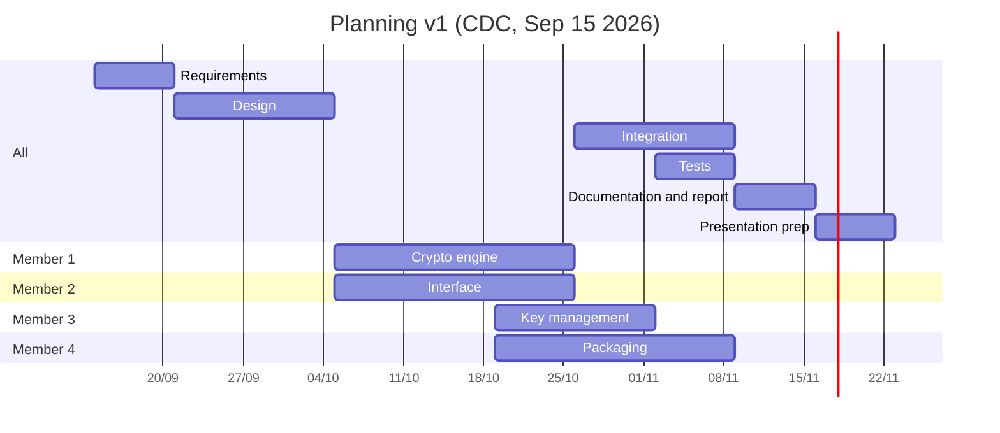

# Planning v1: initial plan (CDC, Sep 15 2026)

The plan from our cahier des charges (dated **Sep 15 2026**, submitted on Arche): [CryptEasy_CDC.pdf](../CryptEasy_CDC.pdf). This page summarizes it so it can be compared with what came next ([planning v2](planning-v2.md)) and with what actually happened.

---

## Schedule

About 10 weeks, from the validation of the topic to the presentation. Phases mostly follow one another (the crypto engine and the interface run in parallel, packaging overlaps key management), and the development is split by component, one member per component.

| Phase | Weeks | Content | Owner(s) |
|---|---|---|---|
| Requirements | S1 | write and validate the topic with the teacher | all |
| Design | S2 to S3 | software architecture, choice of libraries, interface mockup | all |
| Development: crypto engine | S4 to S6 | key generation, hybrid AES + RSA / EC encryption and decryption | member 1 |
| Development: interface | S4 to S6 | web interface (Streamlit or Flask): file selection, key generation / management screens | member 2 |
| Development: key management | S6 to S7 | import / export, protected storage, contacts book | member 3 |
| Packaging | S6 to S8 | standalone executable (PyInstaller) bundling the whole app | member 4 |
| Integration | S7 to S8 | putting the modules together, fixing inconsistencies | all |
| Tests | S8 | functional tests and edge cases (large files, wrong password, ...) | all |
| Documentation and report | S9 | documentation and final report | all |
| Presentation prep | S10 | slides, rehearsal, demo | all |

The CDC numbers the members 1 to 4 without naming who is who. It gives weeks (S1 to S10), not dates: the chart below takes S1 as the week of Sep 14.

---

## Deliverable as planned

A Python application with a graphical interface to:
- generate a key pair (RSA or elliptic curve)
- encrypt a file for a recipient with hybrid encryption (AES for the file, the recipient's public key to protect the AES key)
- decrypt a received file with your private key (itself protected by a password)
- manage a contacts book of recipients' public keys
- *(depending on progress)* sign a file and verify a signature

Packaged as a standalone executable (PyInstaller): no Python or dependencies to install.

---

## Risks identified

| # | Risk | Impact | Planned mitigation |
|---|---|---|---|
| R1 | bad split of time between the 4 members | schedule delay | short weekly progress meetings, tasks clearly assigned from the start |
| R2 | gap in cryptography skills between members | slows down the core module | pair work on sensitive parts, shared internal documentation |
| R3 | scope creep (features added along the way) | deadlines missed | a minimal scope (MVP) frozen after the CDC |
| R4 | mistakes in key handling (loss, wrong manipulation) | loss of test data, blocked demo | systematic tests, dummy data for demos |
| R5 | late start with the chosen GUI library | interface delay | a simple interface prototype during design, before full development |

---

## Tools planned

- Language: Python 3
- Crypto library: `cryptography`, no reimplementation of algorithms
- Interface: Streamlit or Flask (to be decided during design)
- Packaging: PyInstaller
- Version control and project management: GitHub (shared repo, teacher invited as collaborator)
- Communication: Discord
- Tests: pytest
- Report: Word
