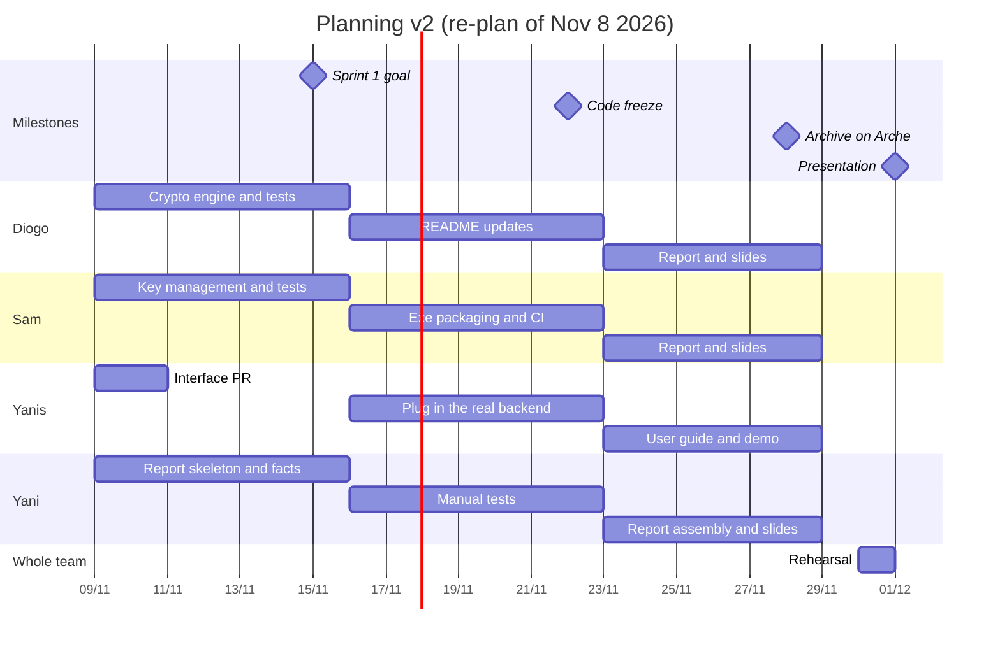

# Planning v2: re-plan of Nov 8 2026

On **Nov 8 2026** we checked where the project stood against the [initial plan](planning-v1.md) and found we were well behind. This page records what we found, what we decided and why, and the new schedule.

Detailed tasks, owners and estimates are on the GitHub board: [CryptEasy project](https://github.com/users/DiogoF-Hub/projects/1).

---

## 1. Where we were on Nov 8

| Done | When | Who |
|---|---|---|
| Cahier des charges (CDC) | Sep 15 | team |
| GitHub repository created | Oct 15 | Diogo |
| Tooling (uv, Makefile, lint, tests), CI, per-member branch workflow | Oct 15 | Sam |
| Technical spec ([TECHNICAL_SPEC.md](../TECHNICAL_SPEC.md)) | Oct 15 to 18 | Diogo |
| `main` protected on GitHub (only the owner merges) | Oct 18 | Diogo |
| Whole interface (Flask + pywebview, FR / EN, tests), running on a **fake backend** | Oct 15, updated Nov 5 | Yanis |

| Not done | Planned in v1 for |
|---|---|
| Crypto engine (`core/`) | S4 to S6 (Oct 5 to 25) |
| Key management (`keystore/`) | S6 to S7 (Oct 19 to Nov 1) |
| Packaging (exe) | S6 to S8 (Oct 19 to Nov 8) |
| Integration and tests | S7 to S8 (Oct 26 to Nov 8) |
| Report, slides | S9 to S10 |

The design was done (the technical spec), about 2 weeks later than planned but in much more detail. The interface was built early, on a fake backend. But the crypto engine, the key management and the packaging hadn't started: the crypto engine should have started on Oct 5, so the development started **about 5 weeks late**. An intermediate set of milestones (MS0 to MS3, weeks 5 to 8, in the README) wasn't met either.

The presentation is on **Dec 1** (our group's last TP), so the final archive is due on Arche on **Nov 29**. That leaves 3 weeks.

---

## 2. Why we fell behind

- **Other projects and assignments:** other university courses had their own projects and deadlines over the same weeks, and they kept taking priority over this one
- **A slow start:** after the CDC there was no short-term deliverable pushing us to begin, and it was hard to get the development going. Nobody really "started the engine"

Two of the risks identified in the CDC actually happened ([risk register](risks.md)):
- **R1, bad split of time between members:** the CDC split the development by component (members 1 to 4), but the development didn't start as planned
- **R2, skill gap:** not every member is comfortable with Python and git, so the component split didn't match who could actually do what

The lesson we take from it: a plan with phases weeks away doesn't create urgency. Short sprints with a goal every Sunday do.

---

## 3. What we decided

### 3.1 Method: 3 one-week sprints instead of sequential phases

v1 mostly chained the phases one after the other (design → development → packaging → tests → report). With 3 weeks left, a mostly sequential plan can't absorb the delay: one late phase pushes everything after it. We switch to **3 one-week sprints**, each with a clear goal, a review and a retrospective at the end:

| Sprint | Dates | Goal |
|---|---|---|
| Sprint 1 | Nov 9 → 15 | the app's core works: a real encrypt → decrypt runs from source |
| Sprint 2 | Nov 16 → 22 | the Windows exe is built and tested. **code freeze** on Sunday Nov 22 |
| Sprint 3 | Nov 23 → 28 | report, slides, demo. **final archive on Arche** on Saturday Nov 28 |

One team meeting per week, at the end of each sprint: review of what got done, retrospective, and who does what in the next sprint. Meeting notes in `docs/pm/meetings/`.

### 3.2 Roles split by skill, not by component

| Member | GitHub | Role in v2 | Why |
|---|---|---|---|
| Diogo CARVALHO | `DiogoF-Hub` | project lead + crypto engine (`core/`), reviews and merges all PRs | owner of the repo, most comfortable with the cryptography part |
| Sam KAFAI | `Enryou` | key management (`keystore/`) + packaging (exe, CI build) | comfortable with code and with the tooling he set up |
| Yanis DISCOURS | `S11nay` | interface: plug in the real backend, Info page, user guide, demo | already built the whole interface |
| Yani SAI | `c0mpr0mized` | report lead, manual testing, slides, meeting notes | not comfortable with Python / git: put where his work counts most for the project (the report and the presentation are 100% of the grade) |

The interface already talks to a **fake backend** through a fixed interface, so the interface, the crypto engine and the key management can be built at the same time without waiting on each other.

### 3.3 Scope

| Kept | Dropped or optional | Why |
|---|---|---|
| key pairs (X25519 / RSA), key passphrase and security levels | file signing (F9) stays a stretch goal, not planned in the sprints | not enough time; the signing key is still generated from the start so it can be added later |
| encrypt / decrypt files and folders (`.zip` package) | Linux binary: optional (sprint 2) | only if the CI build works without extra effort |
| contacts book with fingerprints | macOS build: not a priority, done only if time is left at the end | the Windows exe is the main target; macOS comes last |
| Windows exe (main target) | | |
| FR / EN interface | | already done in the interface |

---

## 4. New schedule

| Date | What |
|---|---|
| Mon Nov 9 | sprint 1 starts |
| Sun Nov 15 | end of sprint 1 |
| Sun Nov 22 | end of sprint 2, **code freeze** |
| Sat Nov 28 | end of sprint 3, **archive uploaded to Arche** |
| Sun Nov 29 | official deadline for the archive (48 h before the presentation) |
| Mon Nov 30 | timed rehearsal |
| Tue Dec 1 | **presentation** |

---

## 5. Comparison with v1

"Delay" compares the planned end in v1 with the new end in v2.

| Phase | v1 (CDC) | v2 | Delay |
|---|---|---|---|
| Requirements | S1 (week of Sep 14) | done Sep 15 | on time |
| Design | S2 to S3 (Sep 21 to Oct 4) | technical spec done Oct 15 to 18 | ~2 weeks, more detailed than planned |
| Crypto engine | S4 to S6 (Oct 5 to 25) | sprint 1 (Nov 9 to 15) | 3 weeks (started 5 weeks late) |
| Interface | S4 to S6 (Oct 5 to 25) | built Oct 15 on a fake backend, updated Nov 5, plugged into the real backend in sprint 2 (Nov 16 to 22) | built on time, finished 4 weeks late |
| Key management | S6 to S7 (Oct 19 to Nov 1) | sprint 1 (Nov 9 to 15) | 2 weeks, now in parallel with the crypto engine |
| Packaging | S6 to S8 (Oct 19 to Nov 8) | sprint 2 (Nov 16 to 22) | 2 weeks |
| Integration | S7 to S8 (Oct 26 to Nov 8) | sprint 2 (Nov 16 to 22) | 2 weeks, done together with packaging |
| Tests | S8 (Nov 2 to 8) | automated in sprints 1 and 2, manual in sprint 2 | 2 weeks, spread out instead of one block at the end |
| Documentation and report | S9 (Nov 9 to 15) | started in sprint 1, finished in sprint 3 (Nov 28) | ~2 weeks, written alongside the work |
| Presentation prep | S10 (Nov 16 to 22) | sprint 3 + rehearsal Nov 30 | the presentation itself is on Dec 1 |

---

## 6. How we track it

- **GitHub board:** one issue per task, assigned, with an **Estimate (h)** and, once done, an **Actual (h)**. Cards move Todo → In Progress → Done.
- **Sprints** are GitHub milestones with a due date and a progress bar.
- **Every PR** closes its issue (`Closes #N`) and is merged by Diogo; `main` is protected.
- **Records** in `docs/pm/`: meeting notes, risk register, decision log.

These records are what the final report uses for the planned vs actual comparison and the estimated vs actual times.
