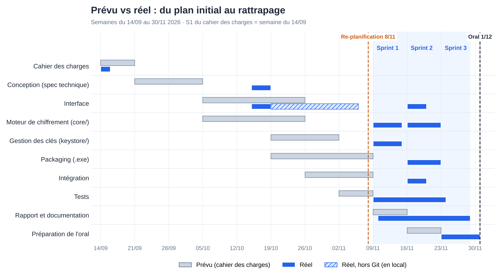

# 2. Organisation réelle et organisation prévue

## 2.1 L'organisation prévue par le cahier des charges

Le cahier des charges du 15 septembre prévoyait environ 10 semaines de travail, de la validation du sujet à la soutenance. Les phases se suivaient : la conception en semaines 2 et 3, le développement de la semaine 4 à la semaine 8, puis l'intégration, les tests, le rapport et la préparation de l'oral.

Le développement était réparti **par composant, un membre par composant** : le moteur de chiffrement pour le membre 1, l'interface pour le membre 2, la gestion des clés pour le membre 3 et l'exécutable pour le membre 4. Le reste (conception, intégration, tests, rapport, oral) devait se faire tous ensemble.

## 2.2 Ce qui s'est passé jusqu'au 8 novembre

Le 8 novembre, nous avons comparé l'avancement réel avec ce plan.

**Ce qui était fait :**
- **la conception**, du 15 au 18 octobre, environ deux semaines plus tard que prévu, mais bien plus détaillée qu'annoncé : une spécification technique complète (`TECHNICAL_SPEC.md`) ;
- **les outils de l'équipe** : le dépôt GitHub, la CI et une branche par membre, mis en place le 15 octobre ;
- **l'interface complète**, construite avant les autres composants sur un faux backend, qui imitait le moteur de chiffrement en attendant le vrai. Une partie de ce travail a été faite en local et publiée sur le dépôt le 5 novembre.

**Ce qui n'avait pas commencé :** le moteur de chiffrement, la gestion des clés et l'exécutable. Le moteur de chiffrement aurait dû démarrer le 5 octobre : **le développement avait donc 5 semaines de retard au démarrage**. Il restait 3 semaines avant le dépôt de l'archive.

Nous avons identifié deux causes. D'abord, nos autres cours avaient leurs propres projets et échéances sur les mêmes semaines, et ils passaient en priorité. Ensuite, après le cahier des charges, aucune échéance proche ne nous poussait à commencer, et personne n'a vraiment lancé le développement. Deux risques prévus dans le cahier des charges se sont réalisés : **R1**, la mauvaise répartition du temps entre les membres, et **R2**, l'écart de compétences en Python et en Git, qui rendait le découpage par composant peu réaliste.

## 2.3 La re-planification du 8 novembre

Avec 3 semaines restantes, un plan dont les phases se suivent ne pouvait pas absorber le retard : une seule phase en retard décale toutes les suivantes. Nous avons donc changé trois choses (`planning-v2.md`).

**Des sprints d'une semaine au lieu de phases.** Trois sprints, chacun avec un objectif clair et une réunion de revue à la fin :

| Sprint | Dates | Objectif |
|---|---|---|
| Sprint 1 | 9 au 15 novembre | le cœur de l'application marche : un vrai chiffrement puis déchiffrement depuis le code |
| Sprint 2 | 16 au 22 novembre | l'exécutable Windows est construit et testé ; gel du code le 22 |
| Sprint 3 | 23 au 28 novembre | le rapport, les slides et la démo ; dépôt de l'archive le 28 |

**Des rôles selon les compétences, plus par composant.** Diogo a pris le moteur de chiffrement et la direction du projet, Sam la gestion des clés et l'exécutable, Yanis l'interface, qu'il avait déjà construite. Yani, moins à l'aise avec Python et Git au début, a pris le rapport, les tests manuels, les slides et les comptes rendus : la partie qui compte pour toute la note. Il a finalement pris du code lui aussi : l'archivage des dossiers et leur extraction sécurisée (#9), puis une partie des correctifs de sécurité (#60). Grâce au faux backend, l'interface, le moteur et la gestion des clés pouvaient avancer en même temps sans s'attendre.

**Un périmètre réduit.** La signature de fichiers est restée un objectif secondaire, le binaire Linux est devenu optionnel et la version macOS est passée en dernière priorité, pour concentrer l'effort sur l'exécutable Windows.

La leçon que nous en tirons : un plan avec des phases lointaines ne crée pas d'urgence. Des sprints courts, avec un objectif chaque dimanche, si.

## 2.4 Ce qui s'est passé ensuite

La figure 1 compare le planning du cahier des charges au déroulé réel. Après la re-planification, chaque phase se termine 2 à 3 semaines après la date du cahier des charges, **mais la date de rendu est tenue** : l'archive est déposée le 28 novembre et l'oral a lieu le 1er décembre.

Les objectifs des sprints ont été atteints :
- **Sprint 1 :** le chiffrement hybride fonctionne depuis le 14 novembre. Seuls les tests unitaires du moteur (#10) ont été décalés au sprint 2, décision prise à la revue du 14 novembre.
- **Sprint 2 :** l'exécutable a été publié le 22 novembre (version `1.0.0rc1`). Les tests manuels ont suivi le 22 et le 23, avec un jour de retard : l'exécutable était arrivé le dernier jour du sprint.
- **Sprint 3 :** *(à compléter le 28 novembre)*.

L'organisation a continué de s'adapter en cours de route. Le 10 novembre, le découpage d'un dossier en archive (#9) est passé de Diogo à Yani, parce que Diogo avait 26 heures prévues au sprint 1, la plus grosse charge de l'équipe. Le 24 novembre, nous avons abandonné le document Word partagé pour écrire le rapport en Markdown, une section par fichier, parce que l'édition à plusieurs cassait la mise en forme.

## 2.5 Nos outils de suivi

- **Un board GitHub** : une issue par tâche, avec une personne assignée, une estimation et le temps réel. C'est la source de la section 3.
- **Une pull request par tâche**, liée à son issue et relue avant d'arriver sur la branche principale. Seul Diogo, propriétaire du dépôt, peut fusionner.
- **Une intégration continue** qui lance les tests automatiques sous Windows et Linux à chaque modification.
- **Une réunion à la fin de chaque sprint**, sur Discord, avec un compte rendu dans le dépôt (`docs/pm/meetings/`).
- **Un journal des décisions** (`decisions.md`) et **un registre des risques** (`risks.md`), mis à jour à chaque réunion. Ce rapport s'appuie sur eux pour dater et justifier chaque choix.
