# Guide utilisateur CryptEasy

CryptEasy chiffre vos fichiers et vos dossiers pour qu'**une seule personne**, celle que vous choisissez, puisse les ouvrir. Vous n'avez **aucun mot de passe à envoyer** : chacun a sa propre paire de clés.

Ce guide suit un exemple : **Bob envoie un dossier à Alice**.

1. [Installer et lancer](#1-installer-et-lancer)
2. [Créer sa paire de clés](#2-créer-sa-paire-de-clés)
3. [Partager sa clé publique](#3-partager-sa-clé-publique)
4. [Ajouter un contact et vérifier son empreinte](#4-ajouter-un-contact-et-vérifier-son-empreinte)
5. [Chiffrer un fichier ou un dossier](#5-chiffrer-un-fichier-ou-un-dossier)
6. [Déchiffrer un paquet reçu](#6-déchiffrer-un-paquet-reçu)
7. [Messages d'erreur](#7-messages-derreur)
8. [Sauvegarder et retrouver ses clés](#8-sauvegarder-et-retrouver-ses-clés)
9. [Langue et page Info](#9-langue-et-page-info)

## En 30 secondes

| Je veux… | J'ai besoin de… | Je ne partage jamais… |
|---|---|---|
| **recevoir** des fichiers chiffrés | ma paire de clés, et donner ma **clé publique** | ma clé privée, ma phrase secrète |
| **envoyer** un fichier chiffré | la **clé publique** du destinataire, enregistrée dans mes contacts | — |

---

## 1. Installer et lancer

Il n'y a rien à installer : CryptEasy est un seul fichier. Téléchargez-le depuis la page **Releases** du dépôt GitHub.

| Système | Fichier | Lancement |
|---|---|---|
| **Windows** 10 / 11 | `crypteasy-<version>-windows-x86_64.exe` | double-clic |
| **Linux** | `crypteasy-<version>-linux-x86_64.tar.gz` | `tar -xzf crypteasy-*.tar.gz && ./crypteasy` |

- **Windows** : comme l'exécutable n'est pas signé, Windows peut afficher « Windows a protégé votre ordinateur ». Cliquez sur **Informations complémentaires**, puis sur **Exécuter quand même**.
- **Linux** (Debian / Ubuntu) : la fenêtre a besoin de deux paquets du système :
  ```bash
  sudo apt install libwebkit2gtk-4.1-0 gir1.2-webkit2-4.1
  ```

CryptEasy s'ouvre dans **sa propre fenêtre**, comme n'importe quel logiciel. **Fermer la fenêtre quitte l'application.**

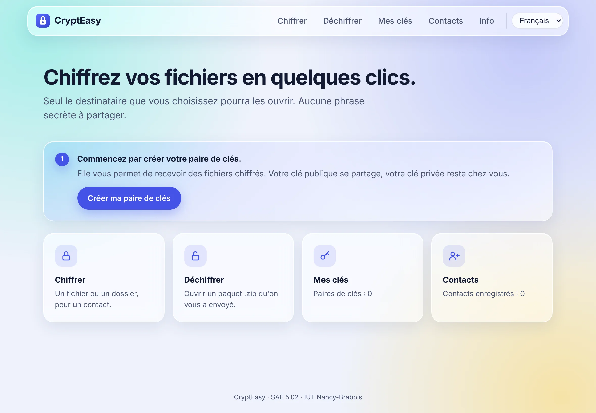

L'interface s'affiche dans la langue de votre système (français ou anglais). On peut la changer en haut à droite.

---

## 2. Créer sa paire de clés

Votre **paire de clés** comprend deux clés :
- la **clé publique**, que vous donnez à vos correspondants. Elle sert uniquement à chiffrer **pour vous** ;
- la **clé privée**, qui reste sur votre PC. Elle seule permet d'ouvrir les fichiers chiffrés pour vous. Elle est verrouillée par votre **phrase secrète**.

Dans **Mes clés** :
1. Donnez un nom à la clé, par exemple « Alice » ou « PC portable ».
2. Laissez le niveau de sécurité **🟢 Fort (par défaut)**. C'est celui qu'on recommande.
3. Choisissez une **phrase secrète** d'au moins 12 caractères. Une phrase facile à retenir marche très bien, par exemple `chat violet sur le toit 42`. Tapez-la deux fois.
4. Cliquez sur **Générer**.

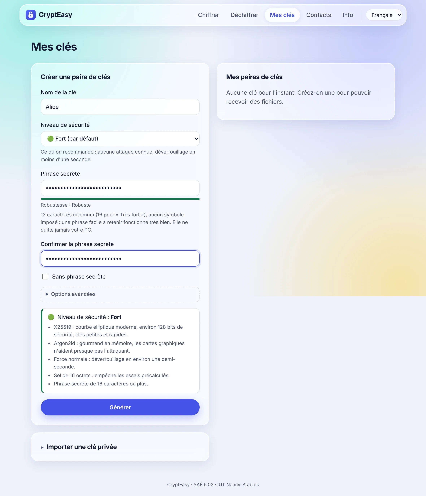

La clé apparaît à droite, avec son **empreinte** : 16 groupes de 4 caractères qui identifient la clé.

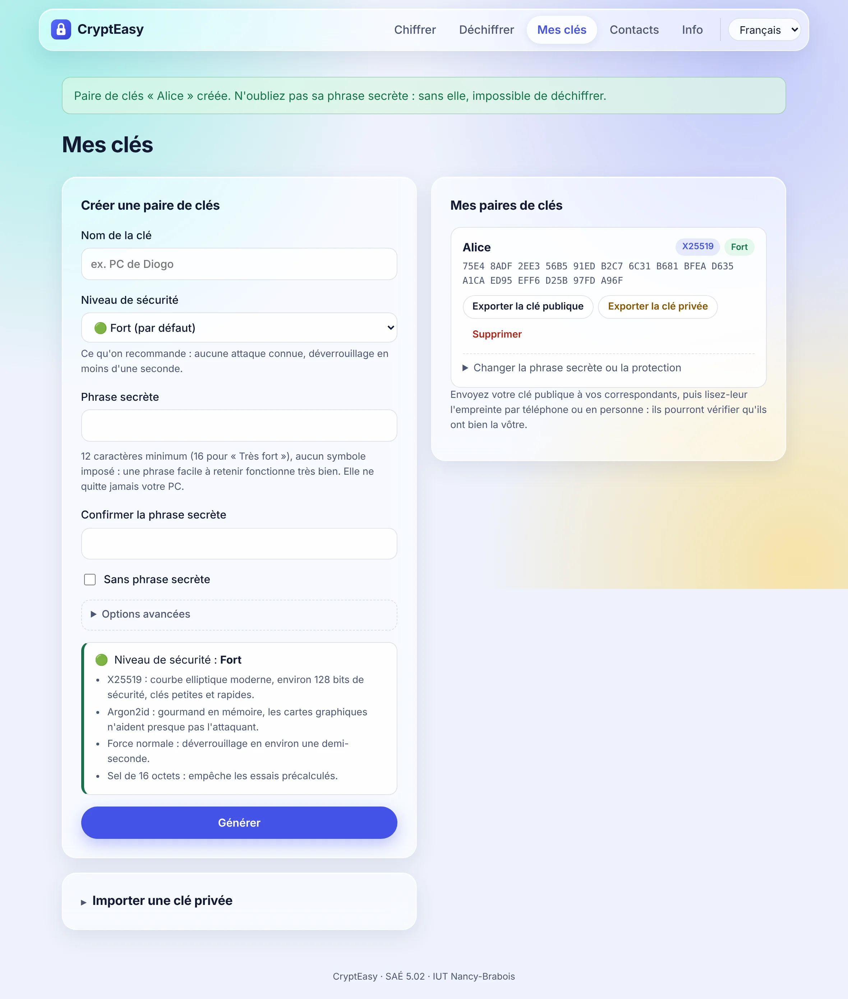

> ⚠️ **Retenez votre phrase secrète.** Personne ne peut la retrouver, pas même nous : sans elle, les fichiers chiffrés pour vous ne s'ouvrent plus.

**Pour aller plus loin :**
- **Options avancées** : vous pouvez choisir chaque réglage vous-même (type de clé, KDF, force, sel). L'encadré « Niveau de sécurité » affiche toujours le niveau de votre réglage **le plus faible**.
- **Sans phrase secrète** : cette case existe pour comparer. Avec elle, n'importe qui qui copie votre clé peut lire vos fichiers. Elle n'est pas recommandée.
- **Changer la phrase secrète ou la protection** : ce lien se trouve sous chaque clé.

---

## 3. Partager sa clé publique

Sous votre clé, cliquez sur **Exporter la clé publique**, puis choisissez où enregistrer le fichier `.pem`.

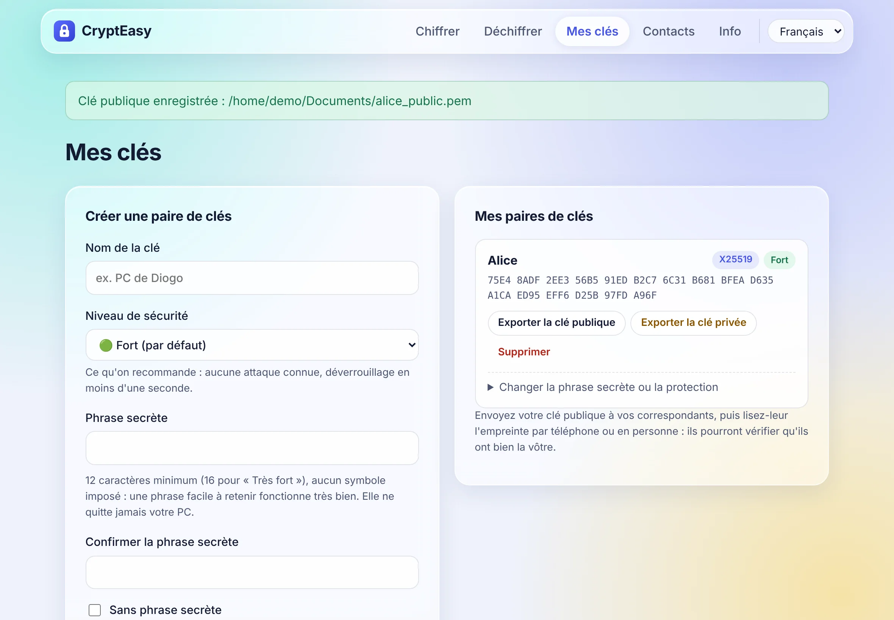

Envoyez ce fichier à vos correspondants comme vous voulez : e-mail, clé USB, Teams… Il n'est **pas secret**.

> ❌ N'utilisez **pas** « Exporter la clé privée » pour la donner à quelqu'un. Ce bouton sert uniquement à faire une sauvegarde (voir la [partie 8](#8-sauvegarder-et-retrouver-ses-clés)).

---

## 4. Ajouter un contact et vérifier son empreinte

Pour chiffrer un fichier pour quelqu'un, vous devez enregistrer sa clé publique. Ici, Bob ajoute Alice.

Dans **Contacts** :
1. Tapez le nom du contact.
2. Cliquez sur **Choisir le fichier…** et sélectionnez son `.pem`. Si vous avez reçu la clé sous forme de texte, ouvrez plutôt **Ou coller sa clé publique** et collez-la.
3. Cliquez sur **Ajouter**.

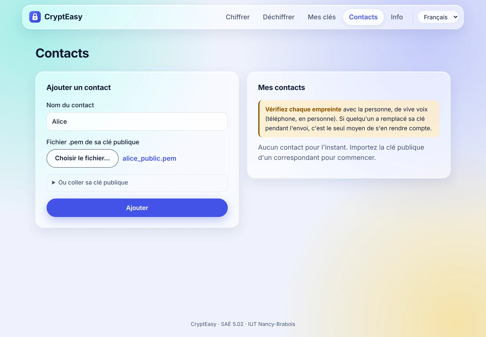

L'empreinte du contact s'affiche.

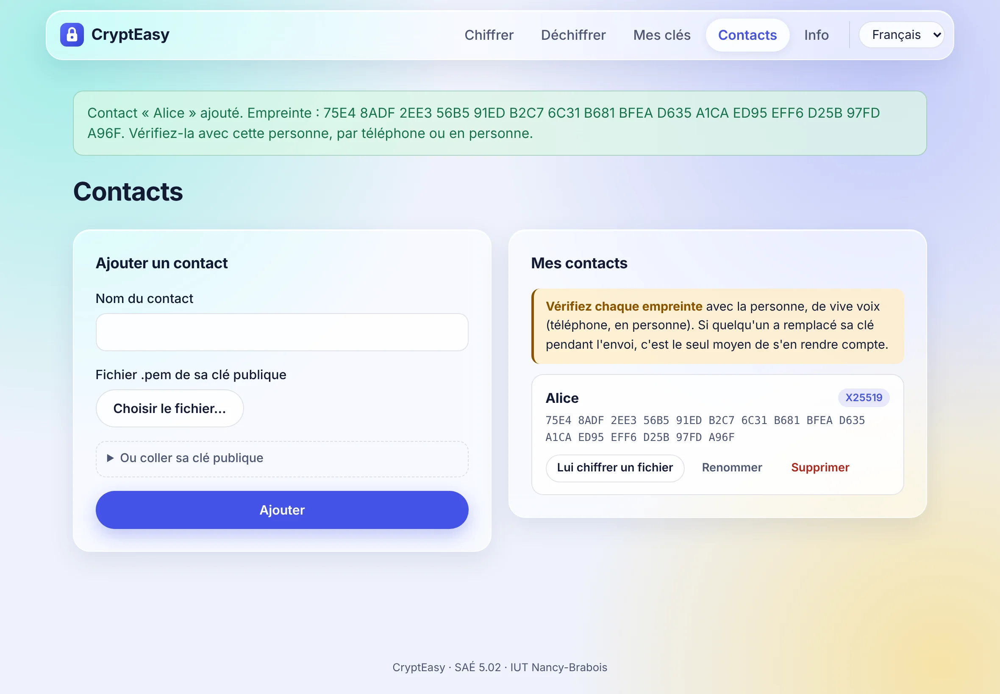

> 🔎 **Vérifiez l'empreinte de vive voix.** Appelez la personne, ou voyez-la en personne, et comparez l'empreinte affichée chez vous avec celle qu'elle lit dans **Mes clés**. Si quelqu'un a remplacé sa clé pendant l'envoi, c'est le seul moyen de s'en rendre compte. Les deux empreintes doivent être **identiques**.

Les boutons **Renommer** et **Supprimer** permettent de gérer le contact. Le bouton **Lui chiffrer un fichier** ouvre directement la page Chiffrer, avec ce contact comme destinataire.

---

## 5. Chiffrer un fichier ou un dossier

Dans **Chiffrer** :
1. Cliquez sur **Choisir un fichier…** ou **Choisir un dossier…**. CryptEasy affiche la taille et le temps estimé.
2. Choisissez le **destinataire** : un contact, ou une de vos propres clés si le fichier est pour vous.
3. Laissez les **réglages avancés** par défaut (AES-256-GCM).
4. Cliquez sur **Chiffrer…**, puis choisissez où enregistrer le paquet `.zip`.

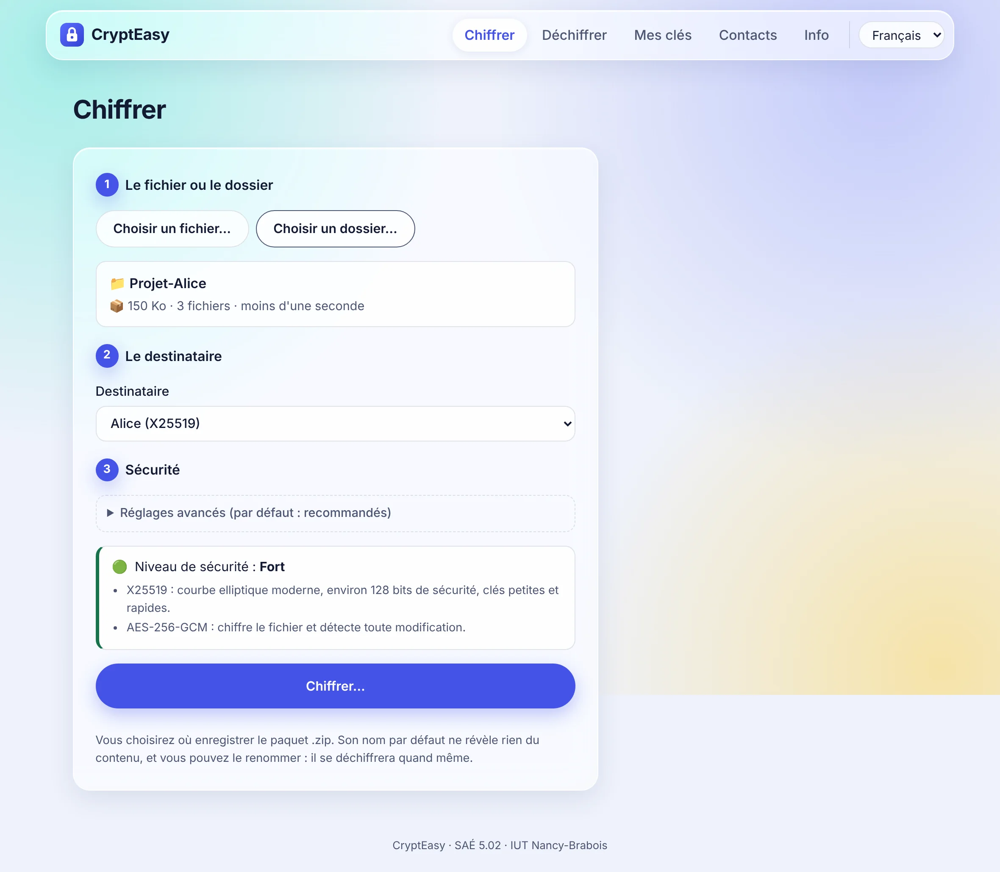

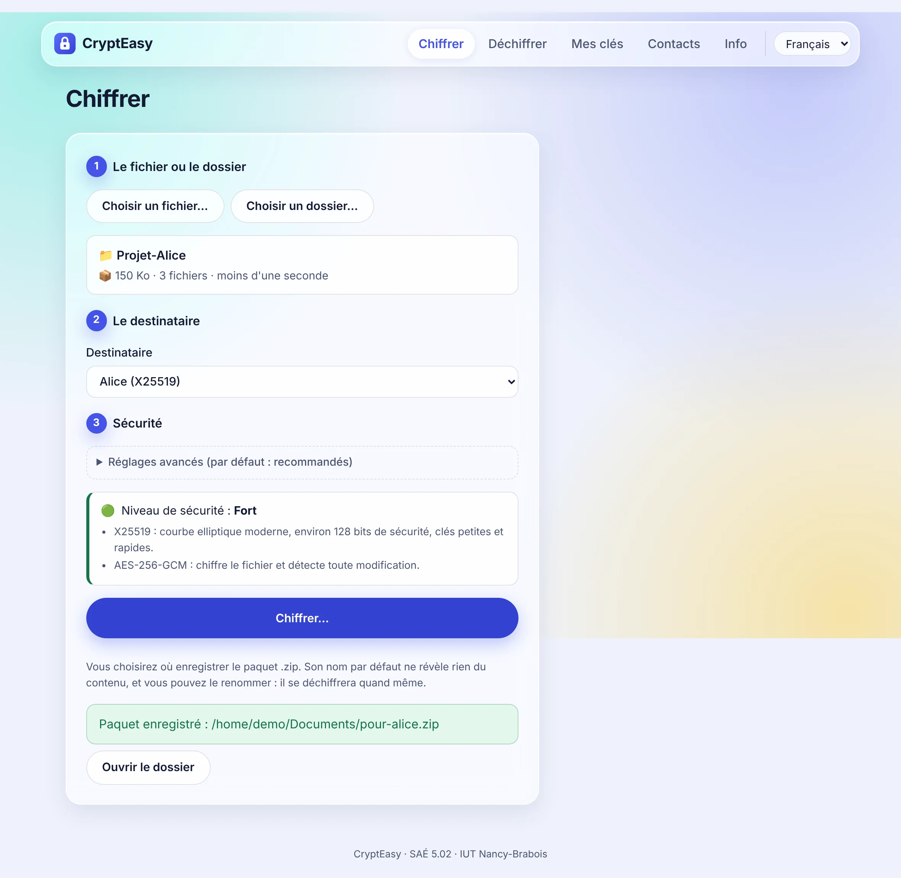

Le paquet est un fichier `.zip` ordinaire : envoyez-le au destinataire comme vous voulez.
- Son nom par défaut (`crypteasy_2026-11-23_1615.zip`, par exemple) ne révèle rien du contenu. Vous pouvez le renommer : il se déchiffrera quand même.
- Le nom du fichier d'origine est caché **à l'intérieur** du paquet, chiffré lui aussi.
- Un dossier est d'abord regroupé dans un zip, puis chiffré. Le destinataire retrouve toute l'arborescence.

---

## 6. Déchiffrer un paquet reçu

Dans **Déchiffrer** :
1. Cliquez sur **Choisir le paquet .zip…**.
2. CryptEasy **trouve tout seul la bonne clé** : la ligne « Clé utilisée : … » l'indique.
3. Tapez la phrase secrète de cette clé, puis cliquez sur **Déchiffrer**.

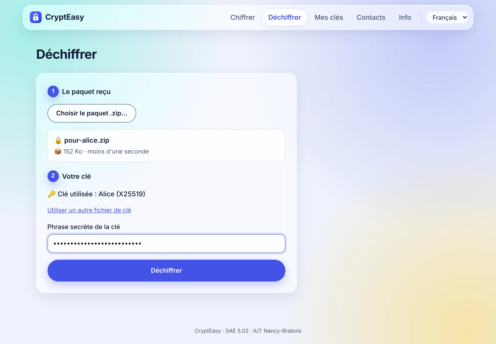

Ensuite :
- **Pour un fichier**, cliquez sur **Enregistrer le fichier…**. Son nom d'origine est proposé.
- **Pour un dossier**, vous avez deux choix :
  - **Le garder en .zip** ;
  - **L'extraire dans un nouveau dossier**. CryptEasy crée un dossier neuf et n'écrit jamais dans un dossier existant.

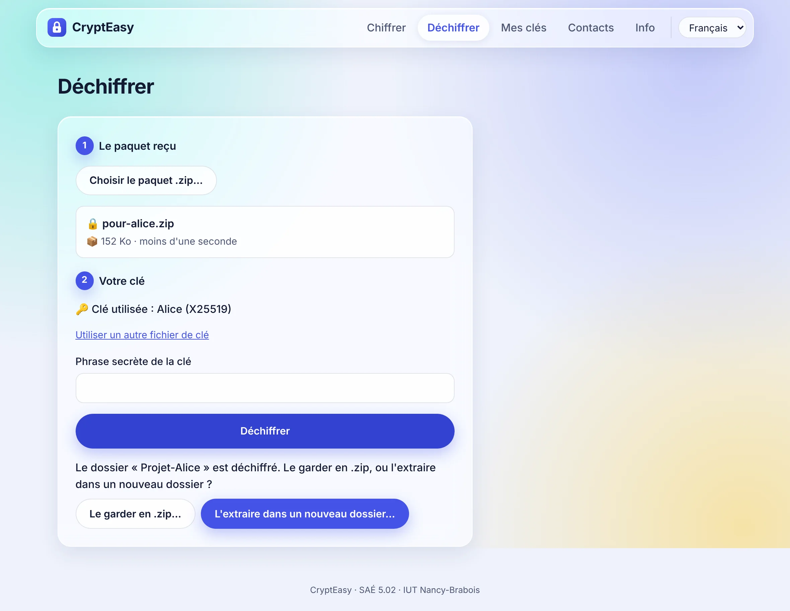

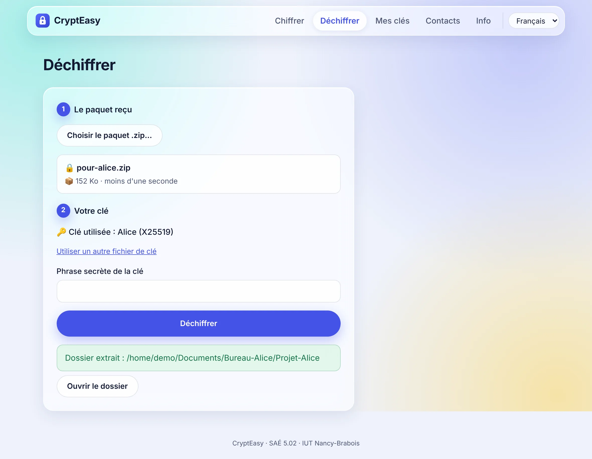

Le bouton **Ouvrir le dossier** affiche le résultat dans l'explorateur de fichiers.

> 🔒 **CryptEasy n'écrase jamais rien.** Si un fichier du même nom existe déjà, il vous demande de choisir un autre nom. Si le déchiffrement échoue, aucun fichier à moitié déchiffré ne reste sur le disque.

---

## 7. Messages d'erreur

| Message | Ce que ça veut dire | Que faire |
|---|---|---|
| **Phrase secrète incorrecte pour cette clé.** | La phrase tapée n'est pas la bonne. | Retapez-la (attention aux majuscules). |
| **Ce fichier n'a été chiffré pour aucune de vos clés.** | Le paquet est destiné à quelqu'un d'autre. | Demandez à l'expéditeur de le chiffrer avec **votre** clé publique. Si vous avez votre clé dans un fichier, utilisez **Utiliser un fichier de clé…**. |
| **Ce fichier est endommagé ou a été modifié. Rien n'a été déchiffré.** | Le paquet a été abîmé pendant l'envoi, ou quelqu'un l'a modifié. | Demandez à l'expéditeur de le renvoyer. |
| **Ce n'est pas un fichier CryptEasy, ou il a été créé par une version plus récente.** | Ce n'est pas un paquet CryptEasy. | Vérifiez le fichier, ou mettez CryptEasy à jour. |
| **Ce n'est pas une clé publique valide.** | Le fichier donné comme contact n'est pas une clé publique. | Demandez à la personne son `.pem` exporté depuis **Mes clés**. |
| **« … » existe déjà : CryptEasy n'écrase jamais un fichier.** | Un fichier porte déjà ce nom. | Choisissez un autre nom. |
| **Ce dossier contient des chemins dangereux** / **est anormalement volumineux** | Le dossier reçu essaie d'écrire hors de son dossier, ou de remplir le disque. | L'extraction est arrêtée et nettoyée. Ne faites pas confiance à ce paquet. |
| **La phrase secrète doit faire au moins 12 caractères.** | La phrase est trop courte. | Allongez-la : une phrase de plusieurs mots marche très bien. |

Voici trois de ces messages à l'écran.

**Mauvaise phrase secrète :**

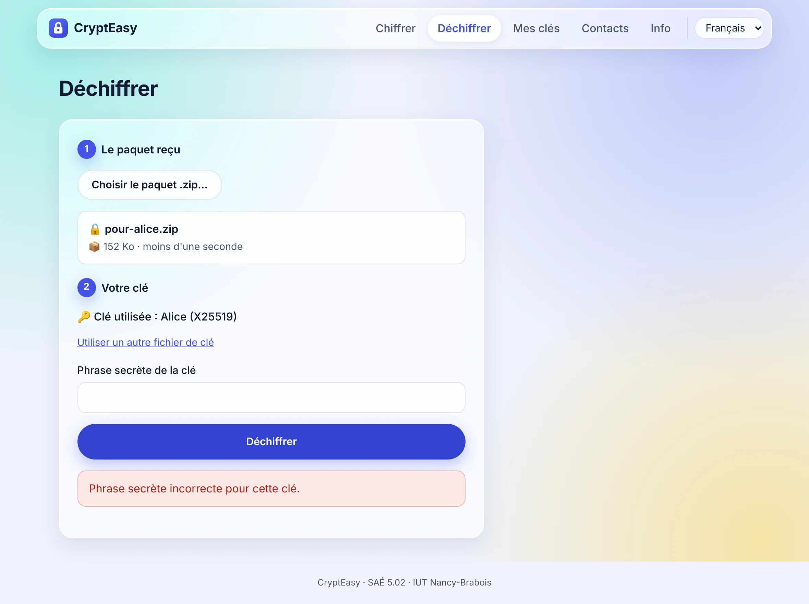

**Paquet modifié** (un seul octet a été changé) :

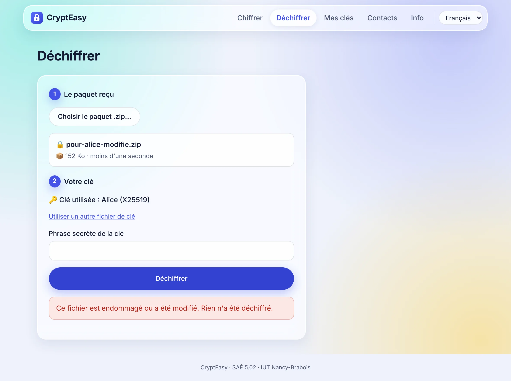

**Paquet destiné à quelqu'un d'autre :**

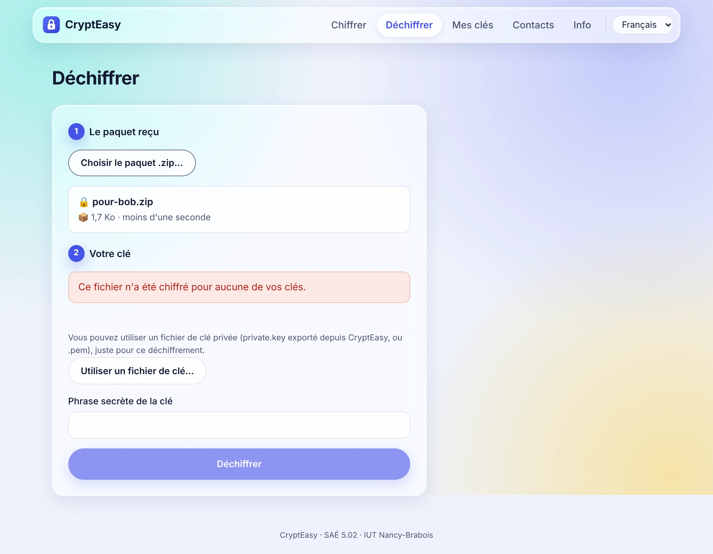

---

## 8. Sauvegarder et retrouver ses clés

- **Où sont mes clés ?** Elles sont dans `%APPDATA%\CryptEasy` sous Windows, et dans `~/.local/share/CryptEasy` sous Linux.
- **Sauvegarder** : cliquez sur **Exporter la clé privée** et rangez le fichier en lieu sûr (clé USB chez vous, par exemple). Il reste verrouillé par votre phrase secrète.
- **Sur un autre PC**, ou après réinstallation : dans **Mes clés**, ouvrez **Importer une clé privée** et choisissez le fichier. Cela marche aussi avec une clé `.pem` faite avec OpenSSL.
- **Perdu la phrase secrète ou la clé privée ?** Rien ne peut être récupéré : c'est voulu, il n'y a pas de porte dérobée. Créez une nouvelle paire de clés, envoyez la nouvelle clé publique, et demandez qu'on vous renvoie les fichiers.

---

## 9. Langue et page Info

- La **langue** se change en haut à droite (Français / English). Le choix est retenu au prochain lancement.

  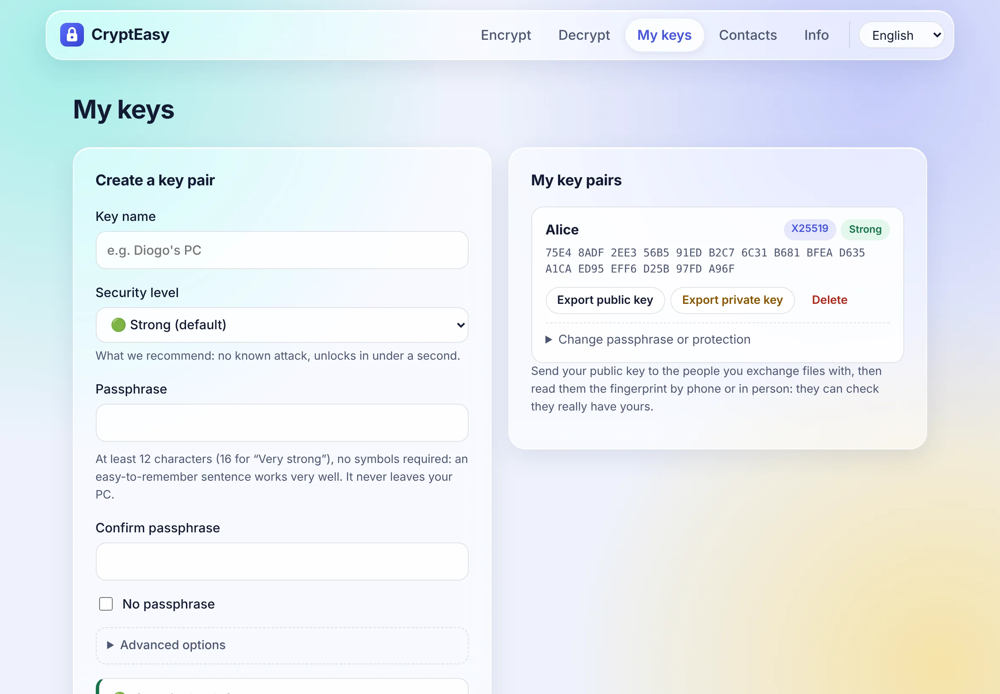

- La page **Info** explique simplement le fonctionnement de CryptEasy :
  - le chiffrement hybride ;
  - ce que veut dire chaque niveau de sécurité ;
  - le contenu d'un paquet (`key.enc` + `file.enc`) ;
  - les bons réflexes.

  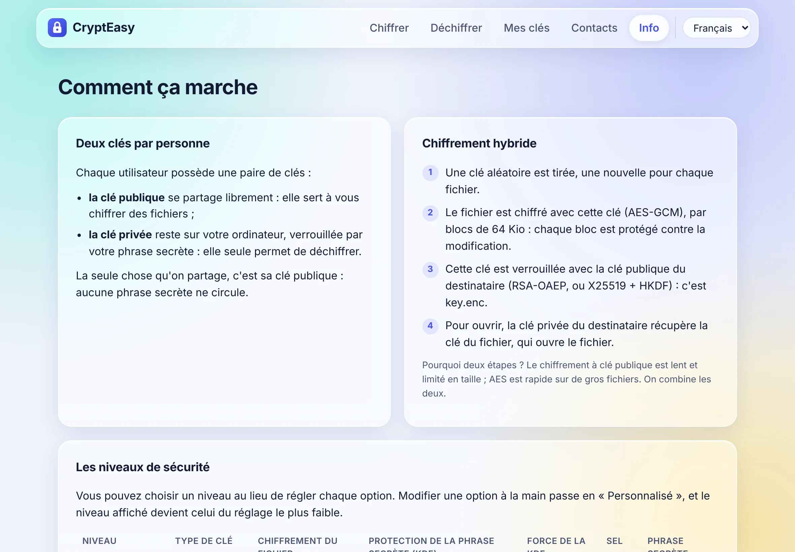
